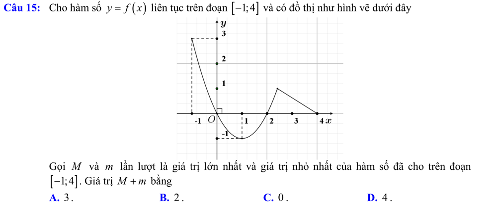
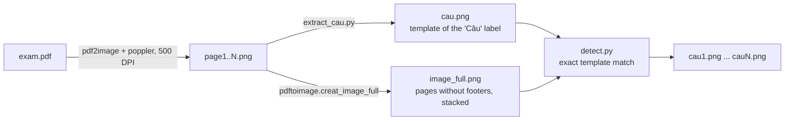

# Exam PDF Question Splitter

Splits a Vietnamese multiple-choice exam PDF (*đề thi*) into one image per question.
The pages are rendered at 500 DPI and stacked into one tall image. A small template of the
bold **"Câu"** ("Question") label is taken from the first page and used to find the start
of every question. Each question is then cropped as its own PNG, including questions that
run across a page break. The approach uses classic image processing (OpenCV/NumPy,
exact template matching) with no machine learning.

Student project from December 2022 (the repository name *Đồ án HTTT* means "Information
Systems project").



## How it works



1. **Render** (`pdftoimage.creat_image`): every PDF page is saved as `pageN.png`.
2. **Build the template** (`extract_cau.extract_cau_`): page 1 is scanned from the bottom up,
   looking only at the left fifth of the page. The first block of ink found there is the
   last "Câu N:" label on the page. The script finds its left edge and crops a 160 px wide
   patch holding the word "Câu" (`cau.png`, shown below).
   
3. **Stitch** (`pdftoimage.creat_image_full`): the footer (page number) is trimmed from each
   question page. The pages are stacked vertically into `image_full.png`, and a copy of the
   template is pasted at the very bottom as an end marker for the last question.
4. **Detect and crop** (`detect.detect_cau`): the template slides down the stitched image
   inside a narrow column window, and every pixel-exact match is a question start. The
   region between two consecutive matches is saved as `cau1.png`, `cau2.png`, ...

## Results

On the included `dethi/dethi1.pdf` (a 50-question maths mock exam, 7 question pages plus
an answer-key page), the pipeline produces exactly 50 crops, `cau1.png` to `cau50.png`, in
about one minute on a CPU.

**Limitations:** the method relies on pixel-exact matching and on the layout of that
specific exam. It finds the template in the left margin, needs a bold "Câu" label, and
assumes the label starts at the same x position on every page. On the second sample,
`dethi/dethi.pdf`, which has a different layout, the template step picks up a fragment of a
formula and only one question is found. `note.txt` lists the next steps that were planned
(translated):

1. Detect questions with YOLO.
2. Use the detected coordinates to sort the questions.
3. Use the sorted coordinates to split out each question, joining images from two pages
   when a question spans a page break.
4. Work out how to separate each question from its answer choices.

## Tech stack

Python 3, OpenCV, NumPy, pdf2image, and Poppler (`pdftoppm`).

## Repository structure

```
.
├── main.py            # entry point: runs the four steps above
├── pdftoimage.py      # PDF -> page PNGs; footer trimming and page stitching
├── extract_cau.py     # builds the "Câu" template from page 1
├── detect.py          # template matching and per-question cropping
├── note.txt           # planned next steps (Vietnamese)
├── requirements.txt
├── docs/              # example images for this README
└── dethi/
    ├── dethi1.pdf     # sample exam the pipeline was tuned on
    └── dethi.pdf      # second sample exam (different layout)
```

## Getting started

### 1. Install Poppler

`pdf2image` calls Poppler's `pdftoppm`, which must be installed on the system:

| OS | Command |
|----|---------|
| Debian / Ubuntu | `sudo apt-get install poppler-utils` |
| macOS (Homebrew) | `brew install poppler` |
| conda (any OS) | `conda install -c conda-forge poppler` |
| Windows | Download a Poppler build (for example from the `oschwartz10612/poppler-windows` releases), unzip it, and either add its `Library\bin` folder to `PATH` or pass it with `--poppler-path`. |

### 2. Install the Python packages and run

```bash
python -m venv .venv && source .venv/bin/activate
pip install -r requirements.txt

python main.py                                   # processes dethi/dethi1.pdf (first 7 pages)
python main.py path/to/exam --num-pages 6        # PDF path without ".pdf"
python main.py --poppler-path "C:\poppler\Library\bin"   # Windows, if Poppler is not on PATH
```

Output goes to a folder named after the PDF. For example, `dethi/dethi1.pdf` produces
`dethi/dethi1/`, containing `pageN.png`, `pageN_cutted.png`, `image_full.png`, `cau.png` and
`cau1.png` ... `cauN.png`. These folders are git-ignored. Use `--num-pages` to leave out
trailing pages that are not questions, such as an answer key.

### Docker

```bash
docker run --rm -v "$PWD":/w -w /w python:3.11-slim bash -c \
  "apt-get update && apt-get install -y poppler-utils && pip install -r requirements.txt && python main.py"
```

## Data

The two sample PDFs are publicly circulated Vietnamese high-school maths exam papers.
`dethi1.pdf` is a 2022–2023 national high-school graduation mock exam (THPT Ninh Giang,
Hải Dương). `dethi.pdf` is a June 2022 grade-12 survey exam (THPT Chuyên Hùng Vương, Phú
Thọ). Both are included only as test inputs, and their copyright belongs to the original
authors.

## License

The code is released under the [MIT License](LICENSE). This does not cover the sample exam
PDFs in `dethi/`.
